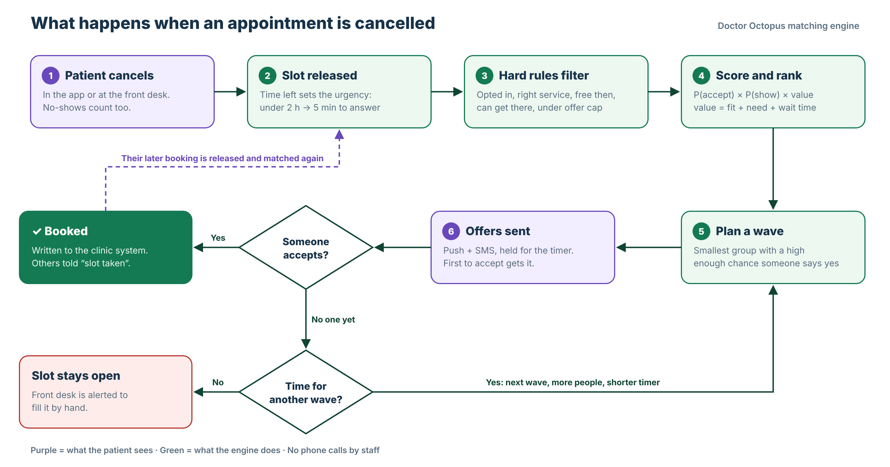

# Doctor Octopus

**Fills cancelled clinic appointments in minutes, without phone calls.**

Built for the natHacks 2026 AIDE challenge. When a patient cancels, Doctor Octopus finds the patients who can actually take the slot, ranks them by how likely they are to accept and show up, and offers the slot in small timed waves until someone books it. The booking goes straight into the clinic schedule, and the patient's old, later booking is released for someone else.



## Results on real clinic data

We replayed every cancellation and no-show from two Edmonton clinics (Jul 2025 to Jul 2026) through the engine.

| | By hand (real) | With Doctor Octopus |
| --- | --- | --- |
| Lost appointments refilled | 314 of 1,165 (27%) | about 754 (65%) |
| Short-notice slots refilled (under 6 h) | 83 of 517 (16%) | about 260 (50%) |
| Extra visits recovered in a year | | **about 440** (range 330 to 490) |
| Provider-hours recovered | | about +450 h |

The range comes from three acceptance assumptions (30%, 45% and 60% of the model's predicted acceptance), each averaged over 10 runs. Slots, timing and real refills come from the clinic exports. The patients receiving offers are simulated, because the exports have no waitlist or availability data. No-shows and slots with under 20 minutes left are never counted as engine fills.

## How the matching works

1. **Slot released.** Time left sets the urgency: how long each patient has to answer, the acceptance target per wave, and the channel (push, SMS).
2. **Hard rules.** Opted in, needs a service this provider gives, fits the slot length, provider and clinic are acceptable, not already booked, free at that time, can get there in time, under the weekly offer cap. In the demo this narrows 661 patients to 15.
3. **Score and rank.** `score = P(accept) × P(show) × value`
   - `P(show)` is a logistic regression trained on 7,219 real appointments (AUC 0.725 on a held-out time split).
   - `P(accept)` uses availability, distance, how much sooner the slot is, past answers and offers this week.
   - `value` weighs fit, clinical need (acute flag, insurance plans) and wait time, so long waits are not ignored.
4. **Offer waves.** The smallest group whose chance of at least one acceptance reaches the target. If nobody accepts, the next wave is larger with a shorter timer.
5. **Book and chain.** First to accept is booked. Everyone else is told the slot was taken. The winner's later booking goes back into matching.

Every ranked patient shows the reasons behind their score, and staff can review every wave before it goes out.

## The demo app

**Clinic portal**
- Dashboard: today's KPIs, recovery opportunities and a live activity feed.
- Schedule: a day calendar with one column per practitioner. Cancel or mark a no-show from any appointment.
- Appointment recovery: chance the slot gets filled versus by phone, the eligibility funnel, the ranked list with score breakdowns, and offer waves (manual or automatic).
- Insights: the replay on real cancellations, with adjustable assumptions.
- Model & settings: model coefficients and live ranking weights.

**Patient app**
- Home: live offers with a countdown, plus recommended practitioners and clinics.
- Find care: clinic search with filters and a map.
- Notifications: offer, confirmation and reminder messages, with an unread badge and push-style pop-ups.
- My appointments: upcoming bookings, accepted offers and offer history.
- Preferences: times, travel and notification settings.

Search, filters and accepting or declining offers work. The rest of the patient screens are UI previews.

**Try it in 60 seconds:** Schedule → Simulate a cancellation → Send wave → Open Lena's app → Accept appointment → My appointments → back to the clinic Dashboard.

## Run it

The quickest way: open `refill-demo/refill-demo-standalone.html` in a browser. No install is needed.

To run from source (Node 18 or later):

```bash
cd refill-demo
npm install
npm run dev        # http://localhost:5173
npm test           # engine tests
npm run build      # production build in dist/
```

To rebuild the data from the clinic exports (needs Python with pandas and scikit-learn):

```bash
python3 scripts/prepare_data.py /path/to/aide_data
npx vite-node scripts/sim_recovery.ts   # reruns the results above
```

## Repository layout

| Path | What |
| --- | --- |
| `refill-demo/src/engine/` | The matching engine: filters, scoring, wave planning, replay. Pure TypeScript with tests. |
| `refill-demo/src/sim.ts` | Live demo state: clock, cancellations, offer waves, simulated answers. |
| `refill-demo/src/clinic/` | Clinic portal screens. |
| `refill-demo/src/patient/` | Patient app screens and the clinic directory. |
| `refill-demo/scripts/` | Data preparation, model training and the results replay. |
| `docs/` | Flowchart and a 1-minute demo video (`demo-video.mp4`). |

## What is real and what is mock

**Real:** providers, services, slot lengths, patient visit and cancellation histories, cancellation timing, whether staff refilled each slot, and the show-up model.

**Mock:** patient names, home and clinic locations, availability, upcoming bookings, waitlist days, language, past offer answers, today's schedule, and the five extra directory clinics in the patient app.

Patient IDs are the anonymized IDs from the exports. Sex, gender and other protected fields are never used for ranking.
